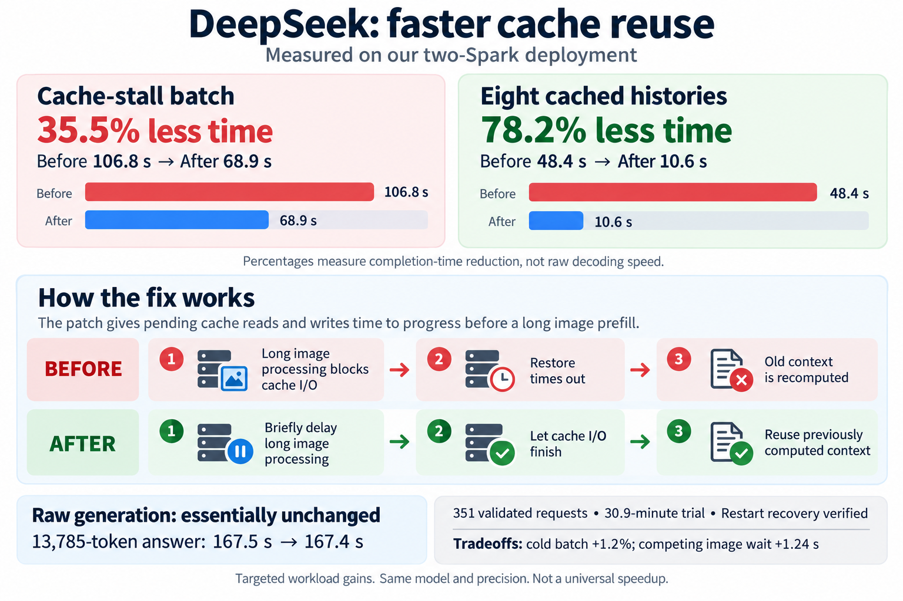
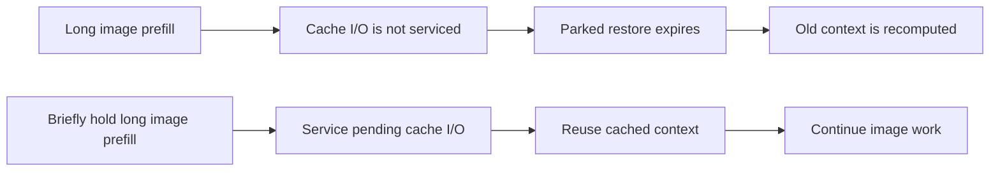

# DeepSeek Spark cache I/O backpressure

An **experimental, opt-in host scheduling patch** on top of [MiaAI-Lab’s DeepSeek-V4.1-Flash-1017 recipe](https://github.com/MiaAI-Lab/DeepSeek-v4.1-Flash-1017-2x-DGX-Sparks), tested on two NVIDIA DGX Spark / GB10 nodes.

The patch lets pending prompt-cache I/O make progress before a long image prefill blocks the engine’s host loop. In our controlled workloads it avoided a restore timeout and unnecessary context recomputation. **It does not increase the model’s raw decoding speed.**



## Measured results

Every request in the main comparison allowed **32,768 output tokens**. Both arms used the same candidate binary, model, precision, limits, workload and frozen starting disk-cache contents; only the new switch changed.

| Workload | Policy off | Policy on | Observed change |
|---|---:|---:|---:|
| Queued restore + long image batch | 106.81 s | 68.93 s | **35.46% less completion time** |
| Cached request’s first token in that batch | 104.75 s | 27.08 s | Shorter wait |
| Eight cached histories, median of three repeat turns | 48.42 s | 10.57 s | **78.17% less completion time** |
| Eight-history cold batch | 315.72 s | 319.51 s | 1.2% longer |
| Competing fresh image’s first token in the restore test | 64.63 s | 65.88 s | 1.24 s longer |
| Actual 13,785-token generated answer | 167.45 s | 167.41 s | Essentially unchanged |

These percentages are **time reductions**, not token/s increases or universal speedups. The eight-history repeat caches were outcomes of each policy’s cold workload, not independently cloned identical warm snapshots. Baseline recomputed one history each repeat; the enabled arm reused 88,064 tokens for all eight.

Validation covered **351 completed requests**, **108 exact paired output comparisons**, histories up to **150,925 tokens**, a **30.93-minute workload trial**, and four exact-output disk restores after a real restart. This is finite, deterministic synthetic validation, not a full-day guarantee or population-p95 estimate. [Results and methodology](docs/validation.md) include the initial latency-check flags and an excluded contaminated attempt.

## What MiaAI and upstream already provide

MiaAI provides the two-Spark recipe, pinned components, packaging and deployment integration, including the EAQ model pack. TensorFold and BertholomusAI provide the native engine, DeepSeek family, kernels and distributed execution. The existing spill/parking work and prefill interleave come from their credited contributors.

**Our addition is small:** one default-off switch, a bounded host-side gate for long image prefills, eight regression tests, and reproducibility/measurement tools. No new model, quantization, CUDA kernel, RDMA implementation or cache format is introduced. See [attribution](docs/attribution.md) and the retained [upstream credits](licenses/MiaAI-CREDITS.md).

## How it works



The ordinary restore-parking path runs first. An image request with **more than 8,192 uncached tokens** may then wait while a restore or cache write is pending. The wait is bounded by the existing load-wait policy. Short images and short cached tails are exempt. Queue precedence, the existing 250 ms interleave setting and numerical computation are unchanged. [Detailed design](docs/design.md).

## Prepare and test without touching a service

Requirements: Git, Python 3.9+, and **Zig 0.17.0** for CPU host tests.

```sh
git clone https://github.com/mjjjjaazing/deepseek-spark-cache-io.git
cd deepseek-spark-cache-io
python3 tools/prepare.py --output /path/to/new-source-directory
python3 tools/run_host_tests.py   --source /path/to/new-source-directory/engine-base   --zig /path/to/zig   --out /path/to/new-test-output   --repeat 1
```

`prepare.py` fetches the pinned public recipe and engine, applies MiaAI’s 26 engine patches, verifies baseline hashes, checks this patch, and adds it to the new recipe checkout. **It does not download weights, build an image, configure hosts or start inference.** The CPU runner expects the baseline starvation test to fail and the patched test to pass; the candidate host suite contains 97 tests.

The pins are deliberately strict:

- MiaAI recipe: [`27741e176a9e5b98c10c9c7d012fd3e4fcdc19b6`](https://github.com/MiaAI-Lab/DeepSeek-v4.1-Flash-1017-2x-DGX-Sparks/tree/27741e176a9e5b98c10c9c7d012fd3e4fcdc19b6)
- TensorFold engine: [`629c524a0ea57512a5342abb498d1b7c25353343`](https://github.com/bertholomus/TensorFold/tree/629c524a0ea57512a5342abb498d1b7c25353343), **plus the recipe’s patches**

A fresh public reconstruction matched all 1,311 files in our measured baseline. No unpublished local commit is needed. Compatibility with later upstream revisions is not assumed.

## Enable on your own pair

Start from a working MiaAI setup and use the prepared recipe’s normal build/deployment process during an idle maintenance window. The additional patch is applied last by the existing Dockerfile. Upstream preparation can download substantial model data and build an image; it is separate from this repository’s source-only preparation.

Add the following to your configured `scripts/local.sh` **after rebuilding with the patch**:

```sh
export TF_SPILL_IO_BACKPRESSURE=1
```

The pinned recipe forwards `TF_SPILL_*` variables to both ranks. The switch is off when absent or not exactly `1`. Exporting it on an unpatched image does nothing. Use your existing single supervisor for restarts; do not launch a second model process beside it.

Preserve model/precision pins, authentication and memory guards. Retain the old image, launch settings and spill directory for rollback. Use a separate candidate spill directory and never override compatibility fingerprints to force old cache reuse. An engine identity change can require existing histories to warm their cache again.

Set the switch to `0` and restart to disable the policy in the candidate image. Full rollback uses your saved original image, configuration and cache. See [deployment notes and measured profile](docs/deployment.md).

## Reproduce hardware workloads

[The benchmark guide](docs/benchmarking.md) describes priming, frozen cache copies, normal-output-limit comparisons, ordered arrivals and a finite soak. The public runners contact an **already prepared loopback server** only when passed `--run`. They do not SSH, restart services or clear caches.

Measured data, request/output hashes and accounting are in [results/measurements.json](results/measurements.json). Run:

```sh
python3 tools/check_results.py
```

Raw private operational archives are intentionally not published. The public dataset omits hostnames, addresses, credentials, private filesystem paths, configuration snapshots, KV contents and generated answer text. The workload source is provided so operators can capture their own raw evidence.

## Status and license

The policy was retained on the measured pair after validation on 29 October 2026. This independent repository is not endorsed by MiaAI, TensorFold, DeepSeek or NVIDIA. It is not an exhaustive novelty claim or a claim to fix every upstream cache issue.

Apache-2.0 for this extension; inherited material retains its notices and licenses. See [LICENSE](LICENSE), [NOTICE](NOTICE) and [licenses/](licenses/).
